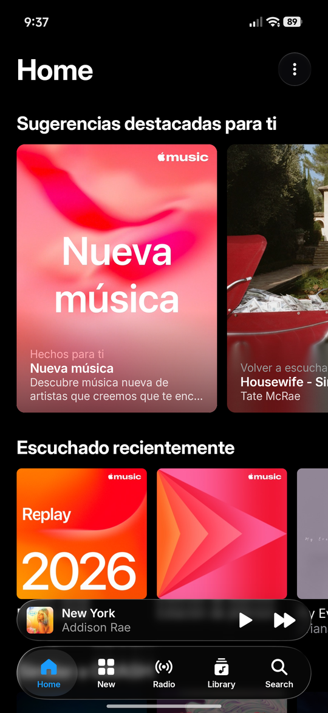
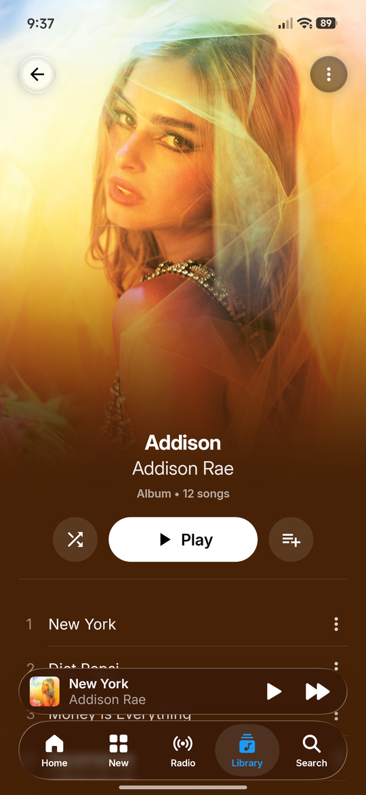
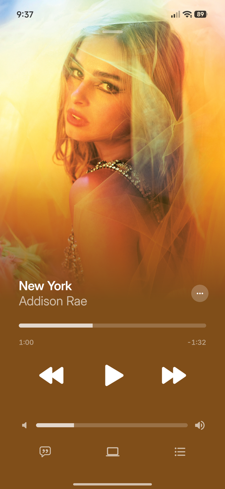
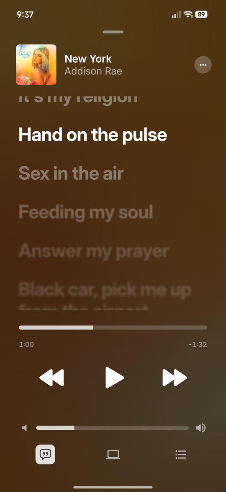
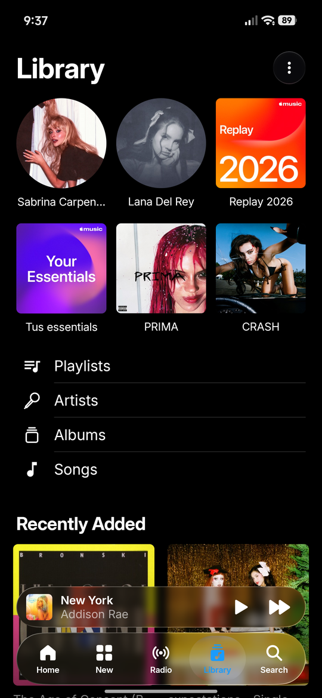

# Remote for Cider

[Español](README.es.md)

A native Android remote for [Cider](https://cider.sh), the Apple Music desktop client. Control playback, browse your library, read synced lyrics and manage the queue from your phone or tablet, with an interface modeled on Apple Music.

> Unofficial project. Not affiliated with Cider Collective or Apple. Apple Music is a trademark of Apple Inc.

## Features

- **Now Playing**: artwork (including Apple Music animated covers), progress, play/pause, next/previous, shuffle, repeat and Cider's volume.
- **Lock screen and notification** controls through a media session; the phone's volume keys change Cider's volume.
- **Up Next**: see the queue, drag to reorder, swipe to remove.
- **Library**: pins, playlists, artists, albums, songs and recently added; swipe a song right to play it next or last.
- **Home and Search**: your Apple Music recommendations, catalog search and browse categories.
- **Synced lyrics**.
- **Tablet layout** with a top tab bar, sidebar and two-column album pages.
- **Finds your computer automatically** on the local network, including your phone's hotspot, so it keeps working when the computer's IP changes.
- English and Spanish.

## Screenshots

<p>
  
  
  
  
  
</p>

## Requirements

- Cider 4 with its API enabled (WebSockets/API in Cider's connectivity settings). Remote for Cider pairs with Cider's own token system: Cider asks you to approve the app.
- Android 8.0 or later, on the same network as the computer (Wi-Fi, Ethernet or the phone's hotspot).
- A small **network bridge** on the computer (see below).

## Setup

### 1. Install the bridge on the computer

Cider's API only listens on `127.0.0.1:10767`, so other devices can't reach it. The bridge forwards port **10768** from your network to it. (Port 10767 can't be reused: Cider checks it at startup and moves to a random port if it's taken.)

**Windows** (built-in port proxy, nothing to install). In PowerShell as administrator:

```powershell
powershell -ExecutionPolicy Bypass -File bridge\windows\install-bridge.ps1
```

It only allows connections from networks marked as *Private*.

**Linux** (systemd user service; needs `socat`):

```sh
bridge/linux/install.sh                      # all interfaces
bridge/linux/install.sh --interface wlp3s0   # only that interface (recommended on laptops)
```

**macOS** (LaunchAgent; needs `brew install socat`):

```sh
bridge/macos/install.sh
```

Each folder has an uninstall script.

### 2. Install the app

Download the APK from [Releases](../../releases) and open it on your phone (allow installing from your browser or file manager when asked).

### 3. Pair

Open the app. It looks for Cider on your network and fills in the address. Tap **Connect** and click **Allow** in the dialog Cider shows on the computer.

## Privacy and security

- Controlling Cider requires the token Cider gives the app when you approve it.
- Cider's live events (what's playing) don't require a token, so with the bridge running anyone on the same network can see what you're listening to. On laptops that join public Wi-Fi, bind the bridge to your home interface or uninstall it.
- Traffic between the app and the bridge is plain HTTP on your local network.
- The app talks only to your computer. Artwork and videos load from Apple's servers.

## Optional: EasyEffects bass toggle (Linux)

`bridge/linux/install.sh --with-easyeffects` installs a small helper on port 10769 that lets the app switch EasyEffects between two output presets you create: **Bocina** (bass on) and **Normal**. The switch appears in the app under the playback device button. The helper only accepts requests with a token Cider accepts.

## Troubleshooting

- **The app can't find the computer**: make sure both are on the same network, the bridge is running and your firewall allows TCP 10768. You can also use ⋮ → *Change Address…*.
- **Xiaomi/HyperOS keeps pausing Cider**: HyperOS pauses other media sessions when one starts. If another app (e.g. KDE Connect or Zorin Connect media control) also mirrors Cider on the phone, disable its media control plugin.
- **The notification disappears after updating the app**: open the app once.

## Building from source

Requires JDK 21 and the Android SDK (compile SDK 37).

```sh
./gradlew :androidApp:assembleDebug
# androidApp/build/outputs/apk/debug/androidApp-debug.apk
```

Project layout:

- `shared/` – Kotlin Multiplatform client for Cider's API: REST, a minimal Socket.IO client, pairing, live player state and a TTML lyrics parser. Includes a small JVM CLI for development.
- `androidApp/` – Jetpack Compose app.
- `bridge/` – network bridge installers.
- `docs/api-v2.md` – notes on Cider's v2 API (in Spanish).

## License

[MIT](LICENSE). The bundled Inter font is under the [SIL Open Font License](docs/licencias/Inter-OFL.txt). The liquid glass tab bar uses [Backdrop](https://github.com/Kyant0/AndroidLiquidGlass) by Kyant and adapts its sample `LiquidBottomTabs` component ([Apache 2.0](docs/licencias/AndroidLiquidGlass-Apache-2.0.txt)).
